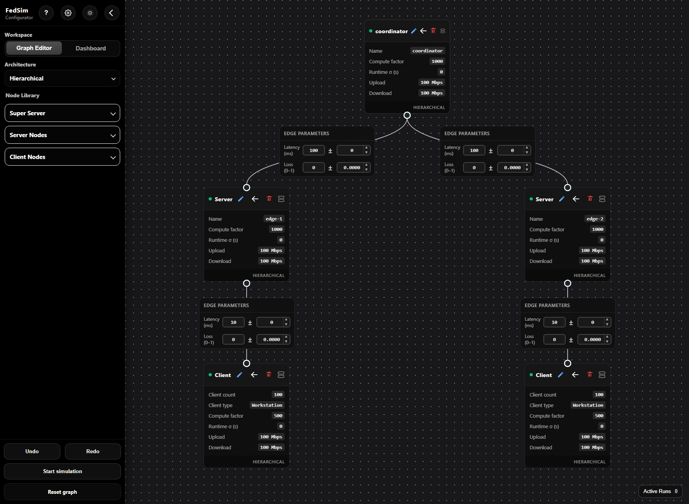
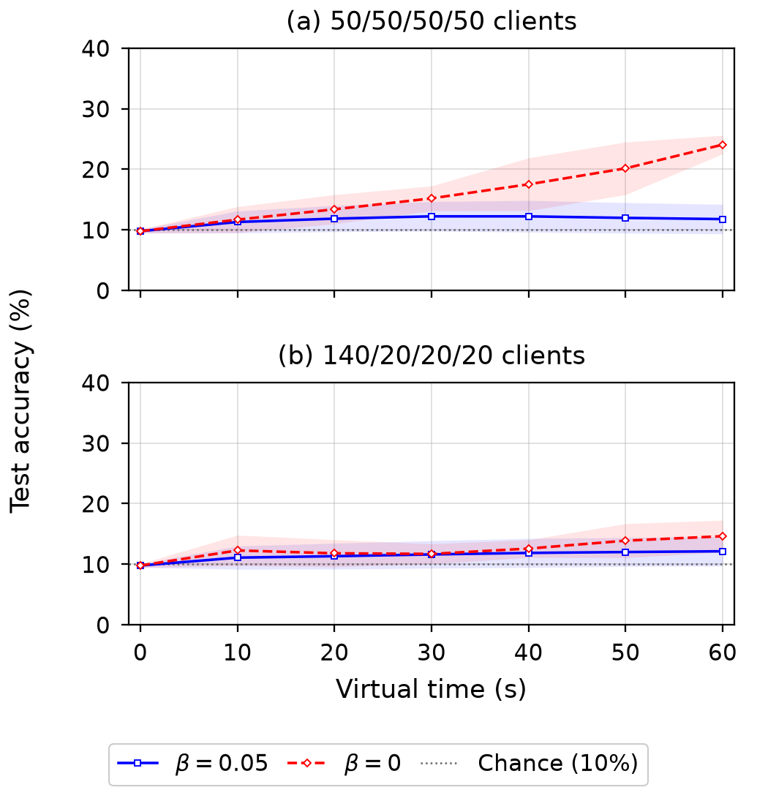

# FedSim Research

**Topology-aware simulation of geo-distributed federated learning.**

FedSim is a research environment for hierarchical and Spyker-inspired asynchronous
federated learning. It combines interactive topology design, real PyTorch training
and a Ray-based simulator that models computation and communication delays.

[**Code and setup**](https://github.com/FedSim-Research/fedsim)
· [Architecture](https://github.com/FedSim-Research/fedsim/blob/main/docs/architecture.md)
· [Experiment guide](https://github.com/FedSim-Research/fedsim/blob/main/docs/experiments.md)

## From topology to experiment

- Configure client placement, node capacity, bandwidth and link delays.
- Capture run definitions and execute logical clients through a bounded worker pool.
- Inspect learning curves alongside update traces, peer exchanges and server checkpoints.

*An example topology in the editor: one coordinator, two edge servers and 200 logical clients.*

## Example study

A 200-client CIFAR-10 study examines how learning-rate feedback interacts with
balanced and concentrated client placement in the asynchronous engine.

  

*Mean test accuracy with one sample standard deviation across three seeded runs.
Each run reports the mean over four server models; the panels show 50/50/50/50
and 140/20/20/20 client allocations.*

The [analysis scripts](https://github.com/FedSim-Research/fedsim/tree/main/experiments/analysis)
connect the figures to verified experiment archives and their producing configurations.
